[](https://doi.org/10.5281/zenodo.23205572)

[-Follow%20%40YOalphabet-1DA1F2?style=for-the-badge&logo=x&logoColor=white)](https://x.com/YOalphabet)

# YOalphabet: a geometric writing system where 4-bit numbers make letters

**Numbers make letters.** 16 glyphs, each one a 4-bit number and an IPA sound. A script, not a language.

<p align="center">
  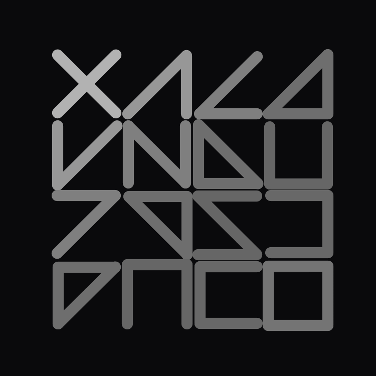
</p>

### [Try the Converter](https://yoalphabet.github.io/YOalphabet/CONVERTER.html) · [Play the Clicker](https://yoalphabet.github.io/YOalphabet/CLICKER.html)

Type or paste text, see the glyphs, save them as a .jpg. Works offline in any browser.

## What it is

YOalphabet is a script of 16 core glyphs. Each glyph lives in a square, and the four edges of that square are four bits. If a bit is 1, the edge is drawn; if it is 0, the edge stays empty. Internal diagonals complete each glyph, so that every glyph has a fixed line density.

One glyph is four things at once:

### 4-bit code ↔ decimal index (0–15) ↔ geometric shape ↔ IPA phoneme

The shape follows from the code by rule, and the code can be read back from the shape. The phonetic value is a convention of the system.

## At a glance

- **16 glyphs, 44 lines:** 32 outer edges and 12 internal diagonals.
- **16 sounds:** 5 vowels and 11 consonants, chosen for wide cross-linguistic availability.
- **English adaptation:** 26 letters, using the 16 base glyphs plus a dot modifier.
- **Two geometric profiles:** Canonical (simple decoding) and Rotational (90° symmetry).
- **Many styles:** geometric, rounded, handwritten, calligraphic, digital.
- **Beyond the page (experimental):** dot-matrix displays, tactile and Braille-like cells, a four-bit hand gesture code.
- **Online converter:** type 0–9 and A–Z, see the glyphs, and save them as a .jpg. Works offline in any browser.

## Quick questions

- **Is YOalphabet a language?** No, it is a script. It ships with a base IPA mapping and an English adaptation, and it can be mapped to other languages.
- **Do I need to know binary to use it?** No. You can read and write the glyphs as a visual script. The binary encoding is optional and meant for software, identifiers and displays.
- **Does it recognize or parse text?** No. Encoding is not understanding: the specification defines glyphs and their encoding, not recognition, parsing or meaning. Claims about efficiency or robustness need separate, reproducible tests.
- **Can I use it?** Yes. MIT License. Forks and experiments are welcome.

<p align="center">
  
</p>

# PART 1: YOalphabet Script Specification

YOalphabet is a deterministic writing system generated from a 4-bit code.
Every glyph is defined by a one-to-one assignment between a geometric symbol, a unique International Phonetic Alphabet (IPA) sound, a decimal number (0–15), and a 4-bit binary code.

## **Binary Code ⟺ Decimal Index ⟺ Spatial Geometry ⟺ IPA Phoneme**

Each character is inscribed within an invariant square bounding box consisting of two independent structural layers:

###  1. Outer Contour (Bit Registers):The four external edges of the square act as geometric representations of bit positions. 
Rule: If a bit is "1", the line is drawn; if "0", it remains empty. They are activated strictly clockwise, starting from the right vertical line:

<p align="center">
  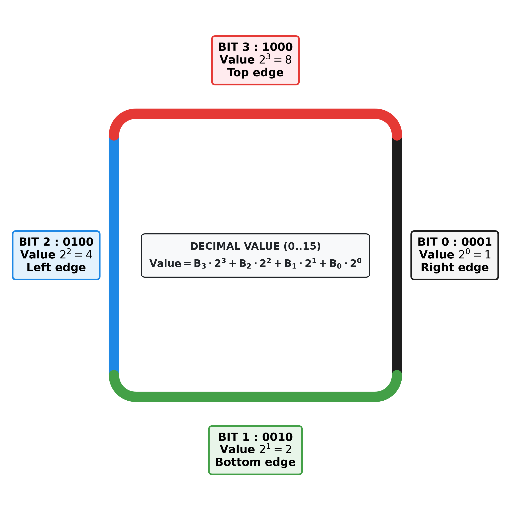
  <br>
  <sub><b>Figure 1:</b> Standard 4-bit positional register mapping, color-coded edge vectors, and decimal value calculation formula.</sub>
</p>


| Bit | Weight | Binary | Shape Element |
| :--- | :--- | :--- | :--- |
| **Bit 0** |  $2^0 = 1$ | `0001` | Right vertical line |
| **Bit 1** |  $2^1 = 2$ | `0010` | Bottom horizontal line |
| **Bit 2** |  $2^2 = 4$ | `0100` | Left vertical line |
| **Bit 3** |  $2^3 = 8$ | `1000` | Top horizontal line |

The integer decimal value of any glyph is calculated directly from its active edge bits:

$$
\text{Value} = B_3 \cdot 2^3 + B_2 \cdot 2^2 + B_1 \cdot 2^1 + B_0 \cdot 2^0
$$

<p align="center">
  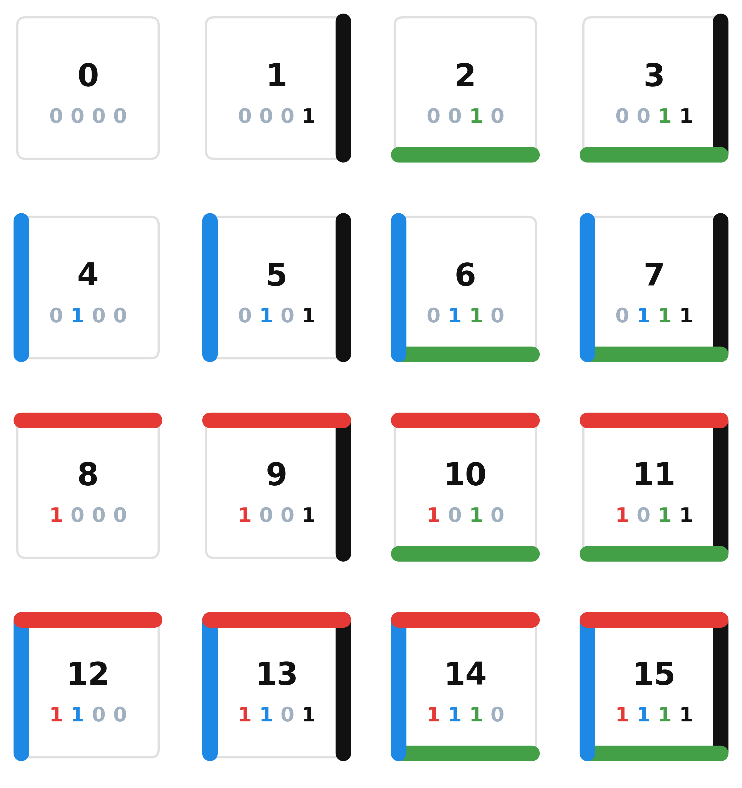
</p>

### 2. Internal Filling (Visual Balance Diagonals): Internal diagonals are used to balance the stroke density and provide a consistent distribution of line elements:

| Density Class | Active Bits | Balancing Element | Target Total Density |
| :--- | :---: | :--- | :--- |
| **Zero Density** | `0` | Two internal diagonals (`/` and `\`) | Fixed density of **2 lines** |
| **Low Density** | `1` | One internal diagonal (`/`) | Fixed density of **2 lines** |
| **Medium Density** | `2` | One internal diagonal (`/` or `\`) | Fixed density of **3 lines** |
| **High Density** | `3–4` | Completely inner-empty | Natural outer density of **3 or 4 lines** |

The entire YOalphabet is constructed from 44 total lines: 32 outer square edges and 12 internal diagonals.

<p align="center">
  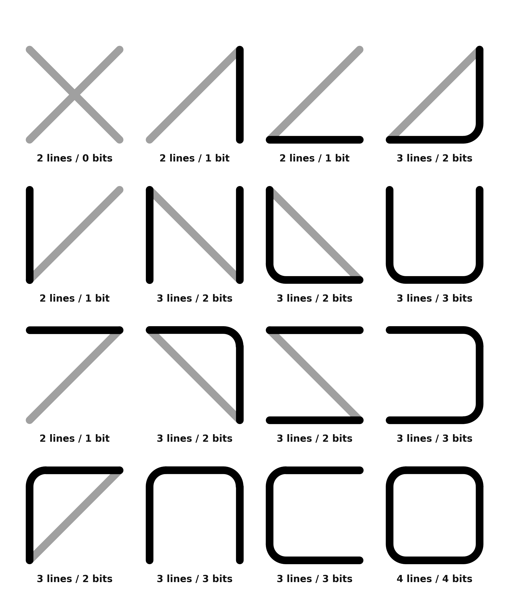
</p>

---

###  Dual Geometric Profiles: Static vs. Rotational Symmetry

By inverting the internal diagonals of just three symbols (**#2**, **#5**, and **#8**), we achieve complete 90° rotational symmetry and spatial isotropy across all bit configurations:

* **1-bit characters (#1, #2, #4, #8):** A single basic corner primitive rotates 90° sequentially as the active bit moves across the four edge registers.
* **2-bit characters:**
  * **Adjacent edges (#3, #6, #12, #9):** Form a continuous 4-fold rotational family (corner-triangle) that maps onto itself under 90° rotations.
  * **Opposite edges (#5, #10):** Inverting the diagonal of **#5** aligns its vector topology with **#10**, making the two parallel-line glyphs exact 90° spatial rotations of each other.
* **3-bit characters (#7, #11, #14, #13):** Containing zero internal diagonals, these 3-sided open-box glyphs inherently possess 100% rotational symmetry across all four spatial orientations.
* **0-bit (#0) & 4-bit (#15):** Feature full 4-fold isotropic symmetry.

### Mode Comparison & Hardware Equivalences
* **Canonical Mode:** Maximizes code simplicity for bare-metal hardware decoders, fixed memory maps, and embedded decoders.
* **Rotational Mode:** Provides perfect spatial isotropy, 2D/3D vector rotation, kinetic transformations, and animation consistency.

* Both options are fully supported and valid.
  
* Both profiles remain **100% mathematically equivalent**—preserving the exact 44-line budget, 4-bit register mapping, and vowel/consonant line density.


<p align="center">
  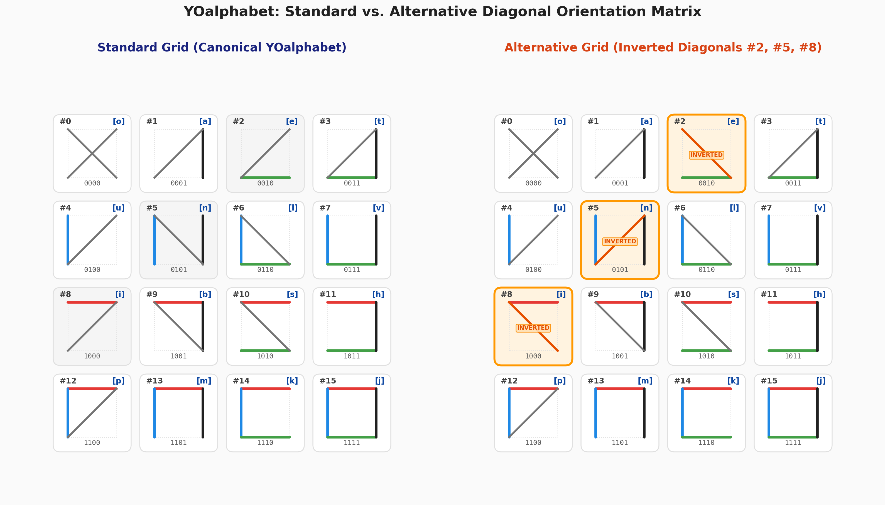
</p>

### The 16 glyphs are assigned 16 phonemes chosen for broad cross-linguistic availability. This is a design choice; the set is not claimed to be the 16 most frequent sounds worldwide:
   
* **Vowels:** `[o]`, `[a]`, `[e]`, `[u]`, `[i]`
* **Consonants:** `[t]`, `[n]`, `[l]`, `[v]`, `[b]`, `[s]`, `[h]`, `[p]`, `[m]`, `[k]`, `[j]`

By doing so, I ensured that the script remains **culturally and historically neutral**, making it selected as the project's base phonetic inventory.

<p align="center">
  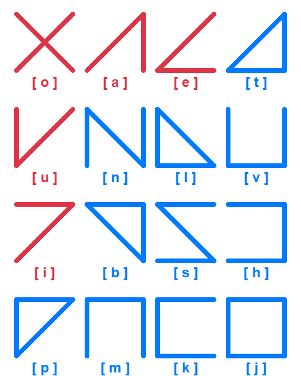
</p>

All 5 basic vowel sounds of the language (`[o]`, `[a]`, `[e]`, `[u]`, `[i]`) are encoded with **0 or 1 active bits**. 
Graphically, each consists of exactly **2 lines** (including compensatory diagonals) and features a diagonal running from the bottom-left corner.

---

### Summary table and color matrix of all 16 glyphs


| Dec | Bin | Contour | Internal | IPA |
| :---: | :---: | :--- | :---: | :---: |
| **0** | `0000` | None | X | `[o]` |
| **1** | `0001` | Right | / | `[a]` |
| **2** | `0010` | Bottom | / | `[e]` |
| **3** | `0011` | Bottom + Right | / | `[t]` |
| **4** | `0100` | Left | / | `[u]` |
| **5** | `0101` | Left + Right | \ | `[n]` |
| **6** | `0110` | Left + Bottom | \ | `[l]` |
| **7** | `0111` | Left + Bottom + Right | None | `[v]` |
| **8** | `1000` | Top | / | `[i]` |
| **9** | `1001` | Top + Right | \ | `[b]` |
| **10** | `1010` | Top + Bottom | \ | `[s]` |
| **11** | `1011` | Top + Bottom + Right | None | `[h]` |
| **12** | `1100` | Top + Left | / | `[p]` |
| **13** | `1101` | Top + Left + Right | None | `[m]` |
| **14** | `1110` | Top + Left + Bottom | None | `[k]` |
| **15** | `1111` | Top + Left + Bottom + Right | None | `[j]` |


   
<p align="center">
  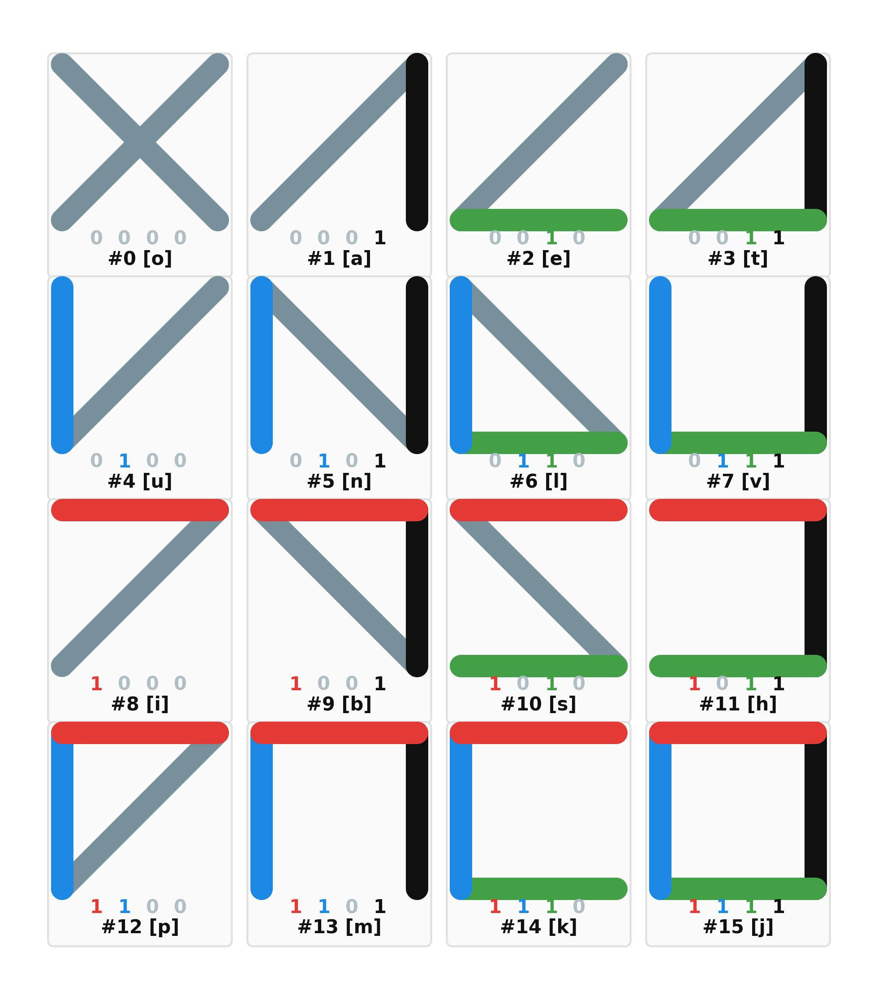
</p>

---
##  Spatial Layout Specification & The 4x4 Script Passport

Every document, digital interface, or isolated text asset within the YOalphabet must conform to a strict spatial, geometric, and calibration protocol to support consistent reading by both people and software:

### 1. The 4x4 Identity Matrix (System Passport)
On physical and digital media, the complete code table is strictly displayed as a monolithic 4x4 matrix ( the logo is not a separate design—it is composed of the system’s complete set of glyphs ), filling sequentially from left to right, top to bottom by increasing decimal index. 
* **Calibration Requirement:** This 4×4 master calibration marker must be permanently rendered in the top-left corner of every document or data block to serve as the system's identification and calibration passport. 
* **Promotional Asset:** This standard matrix layout also serves as the official visual identity to promote the YOalphabet.

### 2. Rigid Spatial Typography Regulations
The layout engine completely eliminates variable tracking and kerning, relying on a deterministic, isotropic matrix grid:
* **Strict Directionality:** The text flow is absolute, running exclusively from left to right and from top to bottom.
* **Isotropic Word Spacing:** A space between words is represented by an empty geometric region exactly equal to the physical bounding box of a single character.
* **Proportional Grid:** The inter-character spacing and inter-line leading must be perfectly identical, maintaining a rigid, predictable square grid across the entire canvas.


<p align="center">
  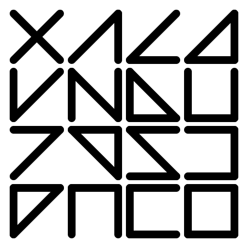
</p>


###  UI/UX & Visual Style Adaptability (Skinning Example)

While the underlying 4-bit hardware topology and mathematical matrix remain 100% invariant, the visual layer of **YOalphabet** acts as an adaptable UI/UX skin. 

Developers and UI designers can re-render the script across diverse visual themes—ranging from high-contrast HUDs and bioluminescent interfaces to retro-futuristic or cyberpunk styles—without breaking the deterministic machine readability.

<p align="center">
  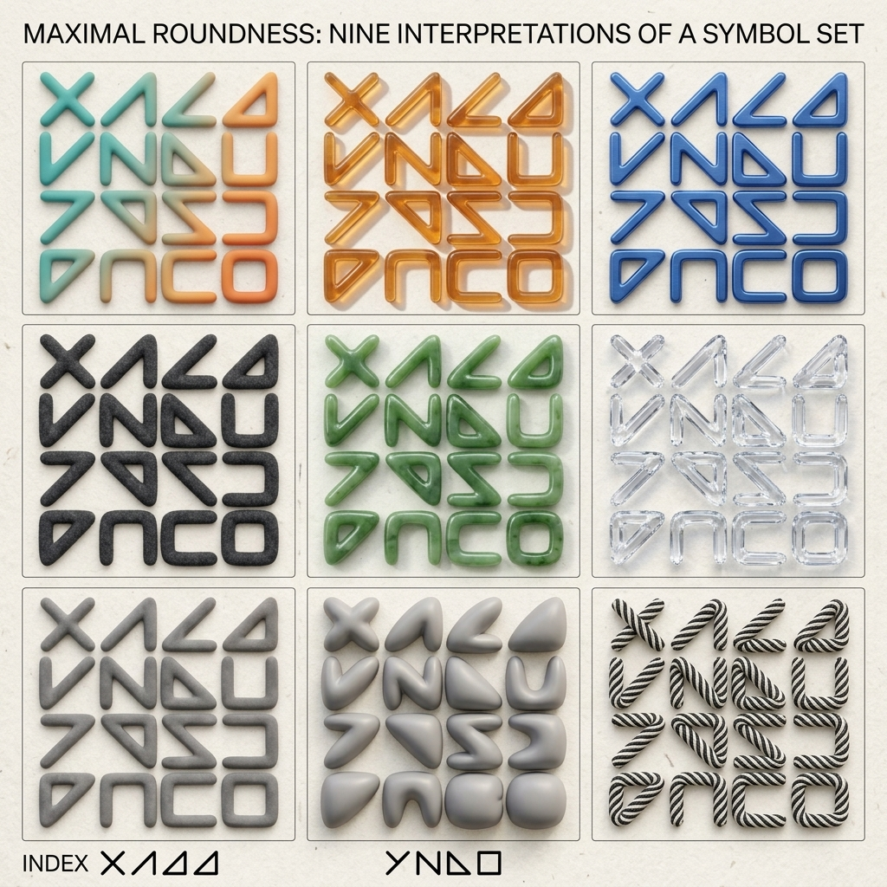
</p>

<p align="center">
  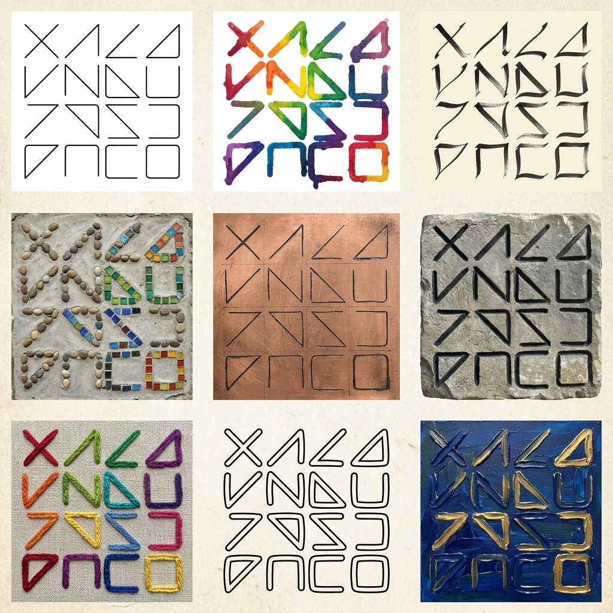
</p>

<p align="center">
  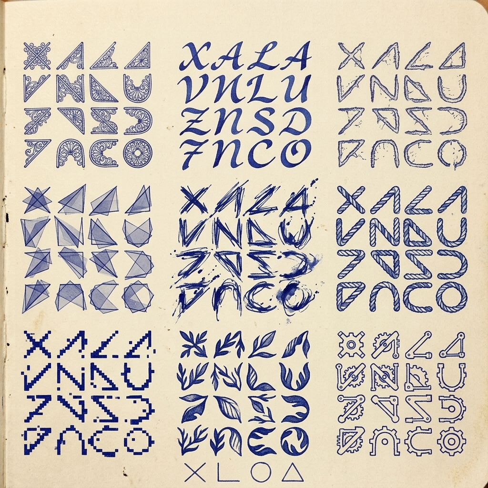
</p>


> **UI/UX Core Principle:** The aesthetic rendering is purely cosmetic. Whether displayed as a glowing neon HUD or a minimalist vector outline, the 4 outer edge registers ($2^0, 2^1, 2^2, 2^3$) maintain an exact, a defined mapping between glyph identifiers and rendered forms.

---
### Developing Handwritten Forms

YOalphabet glyphs can be rendered in canonical geometric, rounded, handwritten, calligraphic, and rapid styles. Handwritten variants may soften corners, vary line weight, and connect strokes, but they must preserve the main contour, internal diagonal placement, and visual density of each glyph.

In rapid handwritten forms, the balancing diagonal may be omitted in the four corner glyphs — 3, 6, 9, and 12 — when the outer contour alone remains clearly recognizable.

An experimental goal is to write most glyphs in one continuous motion. In the current set, 15 of 16 glyphs can potentially be written without lifting the pen; the zero glyph `×` requires two strokes.

Handwritten variation is intended to preserve glyph identity, but readability and machine recognition should be tested separately for each style.

<p align="center">
  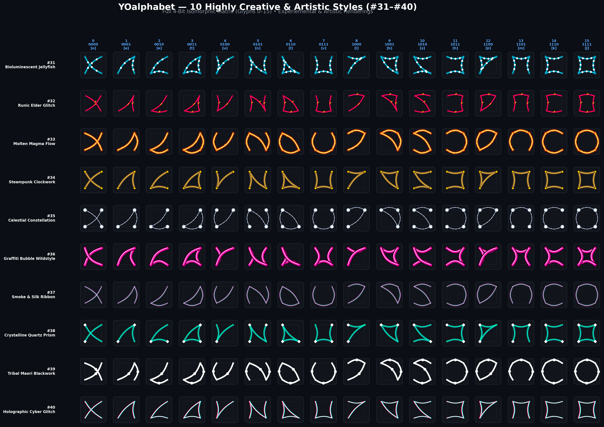
</p>
 
 #### What must remain stable

Across all handwritten styles, the following should remain recognizable:

- the number and placement of main structural lines;
- the distinction between empty, low-density, medium-density, and high-density glyphs;
- the difference between vowels and consonants;
- the identity of each of the 16 glyphs.

A handwritten form may look softer, slanted, or more organic, but it should not become a different glyph.

---

#####  Official Font Files
The compiled font files (`.ttf`, `.otf`) are available directly in the root (`main`) folder of the repository for use in web applications, desktop publishing, and mobile interfaces.

---
# YOalphabet Converter

<p align="center">
  <a href="https://yoalphabet.github.io/YOalphabet/CONVERTER.html">
    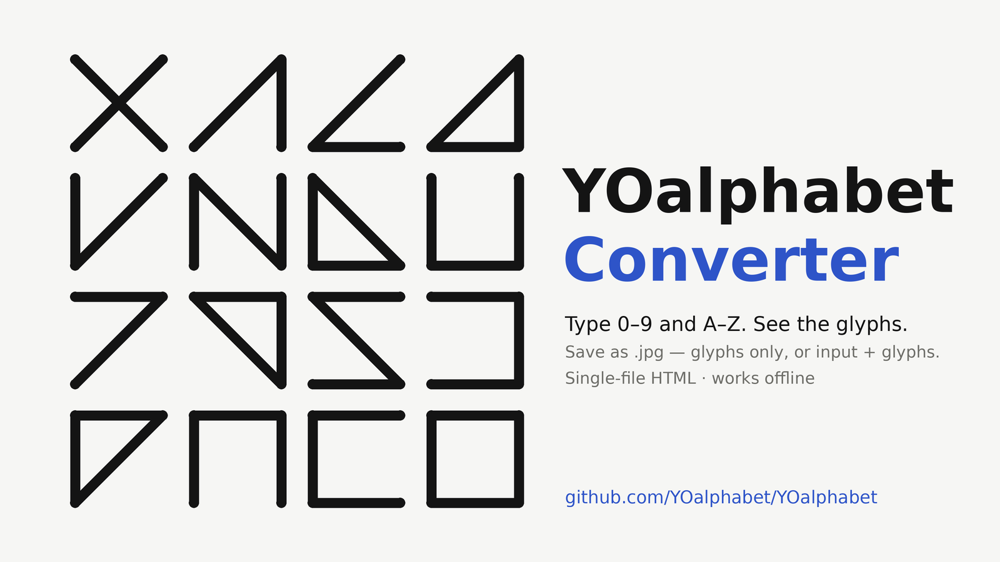
  </a>
</p>


A single-file HTML tool that turns keyboard text (0-9, A-Z) into YOalphabet glyphs and saves the result as a .jpg image. It works offline in any browser, with no installation.

**[Try the YOalphabet Converter online](https://yoalphabet.github.io/YOalphabet/CONVERTER.html)**

Prefer to use it offline? [Download `CONVERTER.html`](https://github.com/YOalphabet/YOalphabet/blob/main/CONVERTER.html) from the repository (click "Download raw file") and open it in your browser.


- Keyboard palette: the 16 base glyphs (O…J) as a 4×4 matrix, the remaining letters (glyph + dot), and digits 0-9.
- Canonical and Rotational diagonal profiles.
- Rounded or sharp 45° and 90° corners.
- Adjustable glyph size, line width, spacing, dot size, colors, and line wrap.
- Optional 4×4 passport matrix and cell grid.
- Export as .jpg: glyphs only, or input text + glyphs.

The converter implements the glyph construction rules from this specification. It is a visualization and export tool; it does not perform recognition or parsing.


---
###  Dot-Matrix & Circle-Grid Rendering (LED, Flip-Dot & Tactile Pin Arrays)

The 4-bit geometric topology of **YOalphabet** scales seamlessly into discrete, low-resolution dot-matrix hardware without losing zero-overhead register mapping. Each 4-bit glyph is mapped onto a minimalist circle-grid (dot matrix), making it natively compatible with low-cost LED matrices, flip-dot displays, e-paper micro-arrays, and physical tactile pin actuators.

<p align="center">
  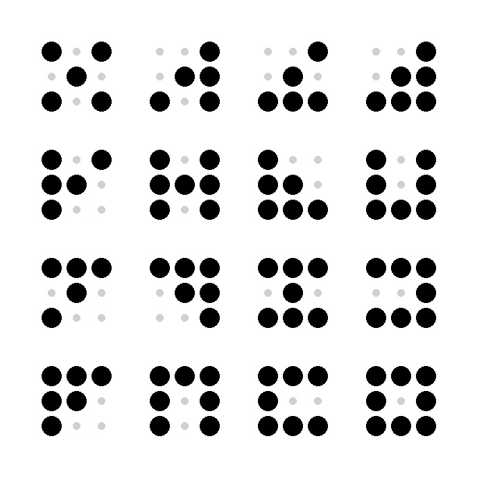
  &nbsp;&nbsp;&nbsp;&nbsp;
  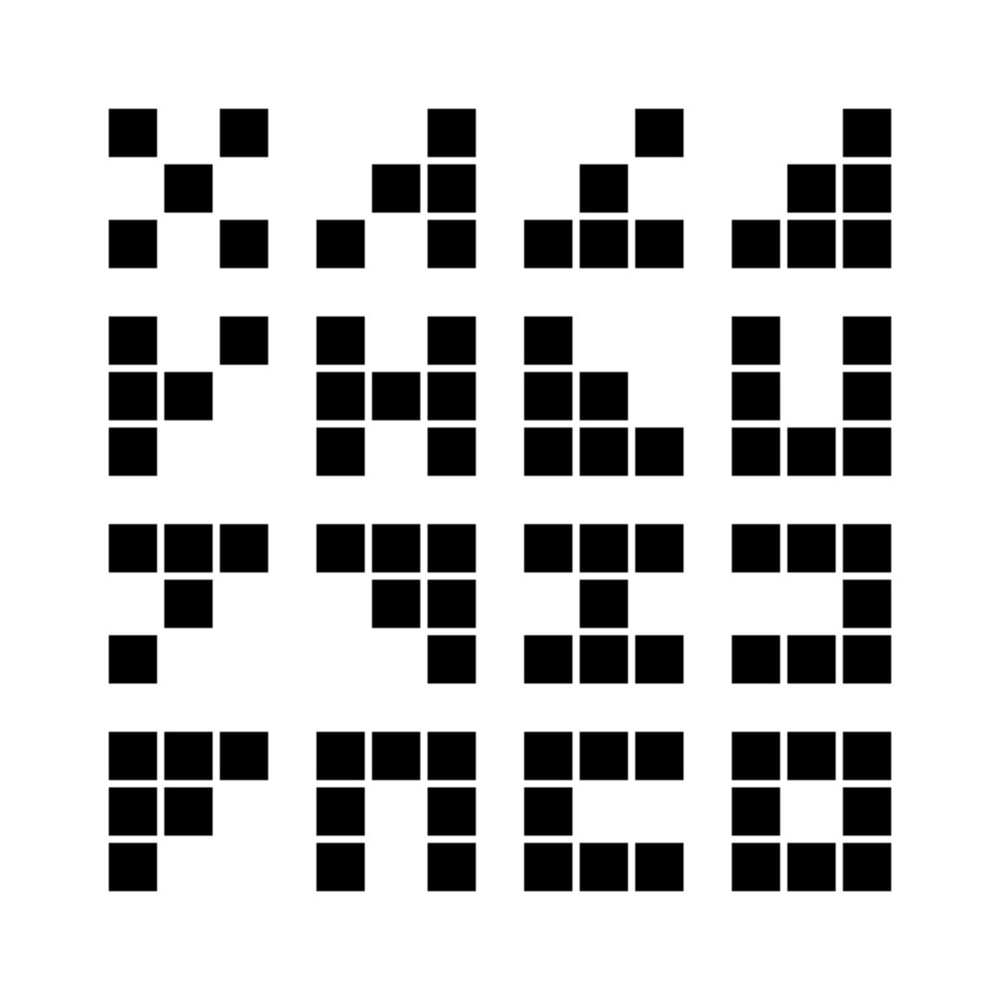
</p>

* **Hardware Parity:** Directly executable on $5 \times 5$ or $7 \times 7$ LED / flip-dot driver chips with zero pixel interpolation.
* **Tactile Readability:** Provides an immediate physical bridge for micro-pin haptic displays and relief embossing.

---

## Experimental Four-Bit Gesture Encoding

The 4-bit full isomorphism of **YOalphabet** naturally extends beyond visual glyphs and digital displays into a **physical 4-bit sign language**. By utilizing just **two fingers on each hand**, anyone can encode and transmit the entire 16-character alphabet in real time without voice, cameras, or digital hardware.

<p align="center">
  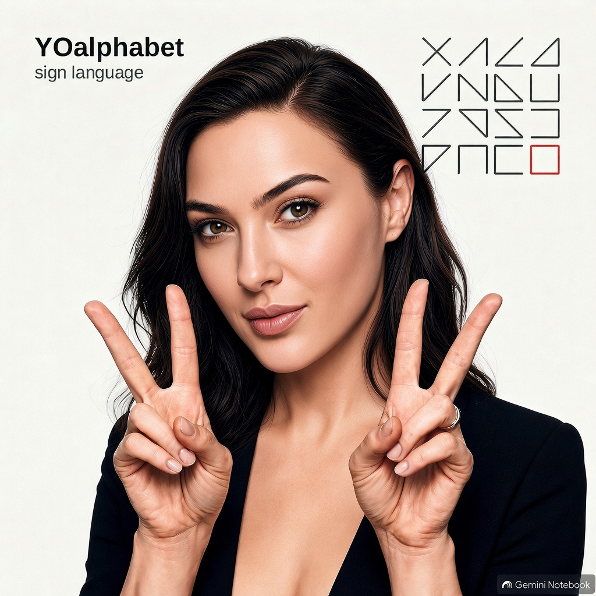
</p>


####  Binary Hand Mapping (2 Fingers per Hand = 1 Nibble)
* **Right Hand (Bits 0 & 1):** Controls the lower bits ($2^0 = 1$ and $2^1 = 2$).
* **Left Hand (Bits 2 & 3):** Controls the higher bits ($2^2 = 4$ and $2^3 = 8$).
* **Combined State (0000 to 1111):** 4 binary finger positions map 1-to-1 directly to the 16 decimal indices (0–15), their corresponding IPA phonetic sounds, and semantic core vectors.

####  Possible use cases (hypotheses, untested)
* **Accessibility:** a very small gesture vocabulary might help in some assistive settings. It would have to be evaluated with deaf, hard-of-hearing and motor-impaired users first, and it does not replace established sign languages or AAC systems.
* **Silent signalling:** a 16-state hand code could be tried where voice is impractical, alongside existing standard signals.
* **Sensors and VR/AR gloves:** a 4-bit finger state is easy to read in principle; practical accuracy is unknown.

---
## Adaptation of YOalphabet to the English Alphabet

This extension retains the sixteen base glyph identifiers and adds a dot modifier to distinguish additional letters. The modifier carries information beyond the base four-bit identifier and must be represented explicitly in digital encoding.

This is an orthographic mapping of English letters, not a phonemic transcription of English pronunciation.

To extend the baseline **YOalphabet** (16 core glyphs) to the full 26-letter American alphabet while preserving its compact 4-bit geometric architecture, a **two-register system** is implemented:

* **Register 1 (Base):** The 16 original letters encoded by clean geometric glyphs. Accounts for **~80%** of letter frequency in standard English.
* **Register 2 (Modified):** The 10 remaining letters encoded using Register 1 donor glyphs with an **internal diacritic dot** placed inside the bounding box. Accounts for **~20%** of letter occurrences in standard English.

<p align="center">
  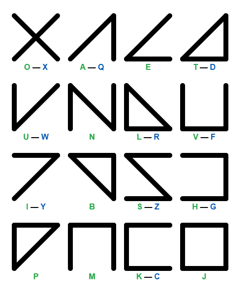
</p>

###  Two-Register Mapping Matrix

| Donor Glyph | Register 1 (Base) | Register 2 (+ Internal Dot) | Pair Type | Phonetic / Graphic Rationale |
| :---: | :---: | :---: | :---: | :--- |
| **[o]** | **O** | **X** | Graphic | Visual shape match (X-cross inside bounding box). |
| **[a]** | **A** | **Q** | Phonetic | Assigned by convention; no phonetic relation to **A**. |
| **[e]** | **E** | | — | — |
| **[t]** | **T** | **D** | Phonetic | Voiced pair for unvoiced stop /t/. |
| **[u]** | **U** | **W** | Phonetic | Labialized pair: vowel /u/ transitions to semivowel /w/. |
| **[n]** | **N** | | — | — |
| **[l]** | **L** | **R** | Phonetic | Pair of liquid sonorants (/l/ and /r/). |
| **[v]** | **V** | **F** | Phonetic | Unvoiced pair for voiced fricative /v/. |
| **[i]** | **I** | **Y** | Phonetic | Y often, but not always, stands for /i/. |
| **[b]** | **B** | | — | — |
| **[s]** | **S** | **Z** | Phonetic | Voiced pair for unvoiced fricative /s/. |
| **[h]** | **H** | **G** | Phonetic | Velar/glottal pair (shared place of articulation). |
| **[p]** | **P** | | — | — |
| **[m]** | **M** | | — | — |
| **[k]** | **K** | **C** | Phonetic | Hard /k/ sound mapped to letter **C**. |
| **[j]** | **J** | | — | — |

---

###  Tactile & Braille Interface YOalphabet

The 4-bit full isomorphism of **YOalphabet** extends naturally beyond visual rendering and computer vision into a high-efficiency tactile writing system. **YOalphabet** is designed for refreshable Braille displays, micro-relief paper embossing, tactile packaging markers, and haptic feedback devices.

Unlike legacy 6-dot or 8-dot Braille systems that require arbitrary memorization of non-isomorphic patterns, **YOalphabet** maintains a direct 1-to-1 physical mapping between raised tactile points, binary hardware registers, and universal IPA phonetic sounds.

<p align="center">
  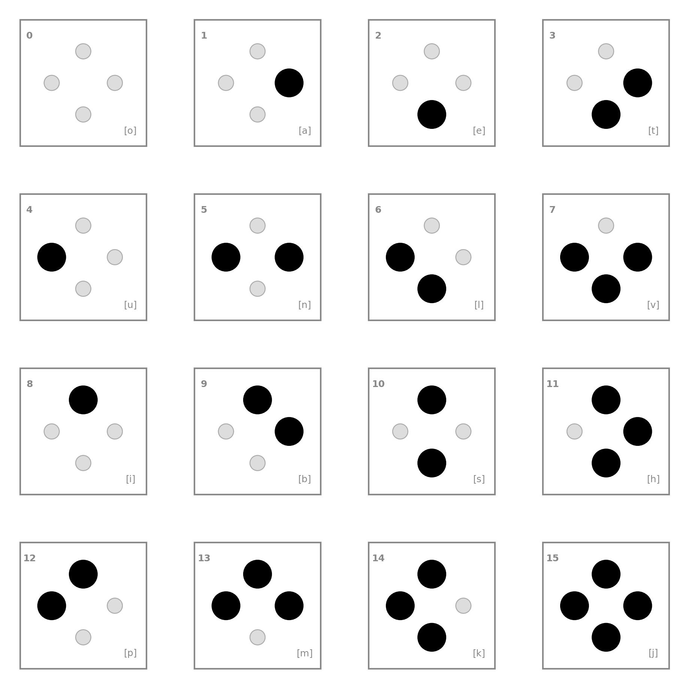
  &nbsp;&nbsp;&nbsp;&nbsp;
  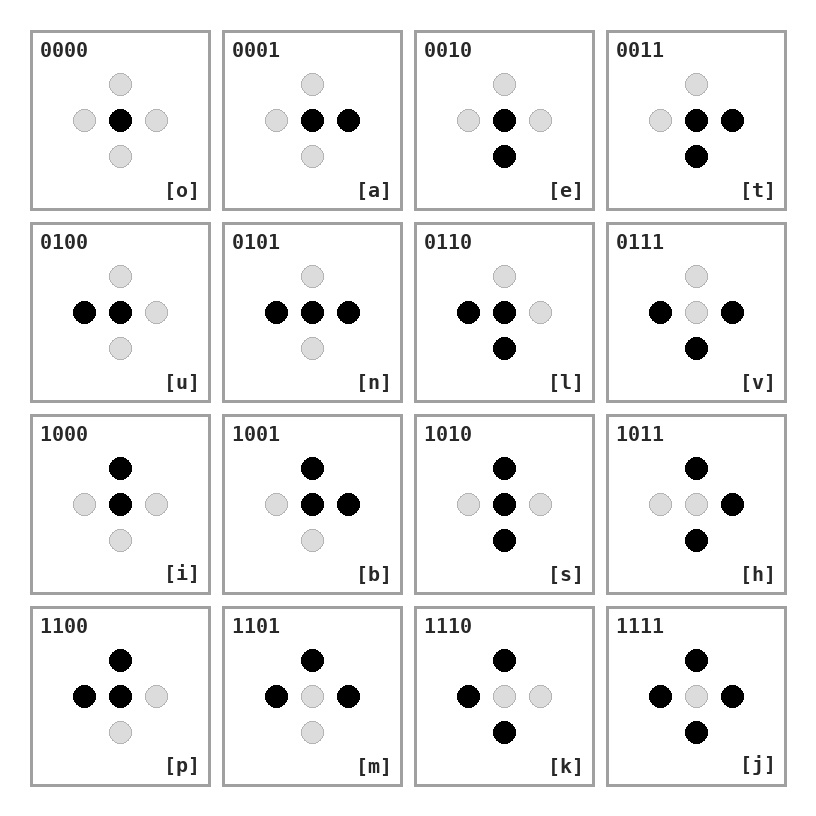
</p>
<p align="center">
  <sub><b>Figure:</b> Standard 4-Dot Pure Binary Matrix (Left) vs. Self-Anchoring 5-Dot Matrix with Central Reference Point (Right).</sub>
</p>

####  Architecture Comparison: 4-Dot vs. 5-Dot Matrix

##### 1. Pure 4-Dot Matrix 
* **Structure:** Minimalist 4-point diamond layout (Top, Right, Bottom, Left).
* **Zero Symbol (`0000` / `[o]`):** Rendered as an empty cell (0 raised dots).
* **Best Used For:** Refreshable digital Braille displays, haptic arrays with fixed physical cell frames, and high-density micro-embossing.

##### 2. Self-Anchoring 5-Dot Matrix 
* **Structure:** 4-point diamond layout + **1 Permanent Center Anchor Dot**.
* **Zero Symbol (`0000` / `[o]`):** Rendered with **only the center dot raised**.
* **Tactile Ergonomics:** The central anchor acts as an instantaneous spatial reference. When sweeping fingertips across embossed paper, the reader immediately locates the cell center without needing external physical bounding boxes or grid lines.
* **Best Used For:** Embossed paper, packaging, tactile signage, and blind reading in rimless environments.
---

## Play with it

[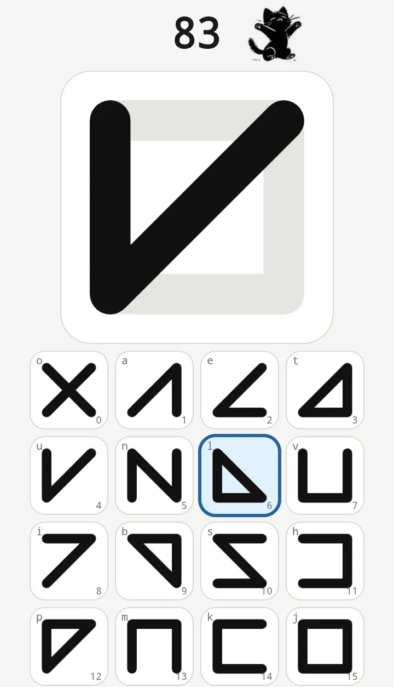](https://yoalphabet.github.io/YOalphabet/CLICKER.html)

**[Play the Clicker](https://yoalphabet.github.io/YOalphabet/CLICKER.html)**: tap the sides of the big glyph to flip its four bits. Match the highlighted glyph in the 4×4 matrix to score a point. Vowels (o a e u i) are voiced, and every point drops a random cat, sometimes a rare animal.

---

### 4-Bit Socionics / MBTI Labelling
A notational mapping of the 16 Socionics/MBTI-style type codes onto 4-bit registers. It is only a labelling convenience: these typologies have limited scientific validation, their letter conventions differ, and no claim is made about personality.

<p align="center">
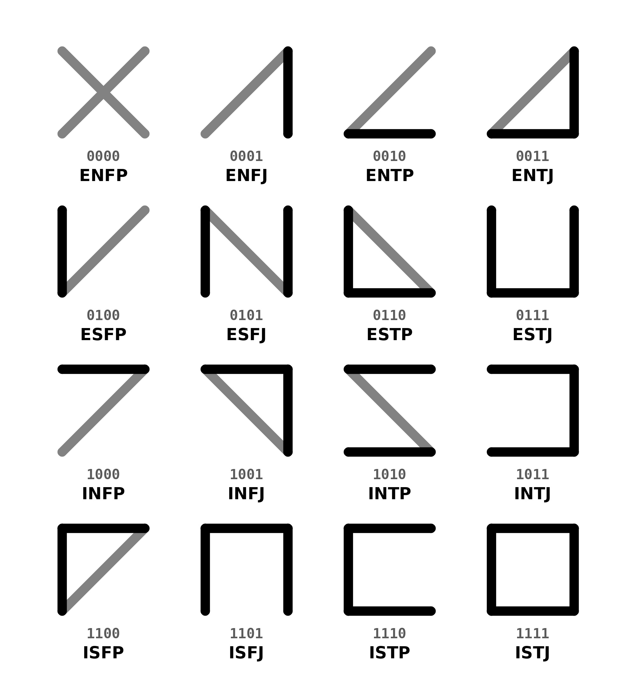
</p>

| Bit Register | Value = `0` | Value = `1` |
| :---: | :--- | :--- |
| **Bit 3** | **E** (Extraversion) | **I** (Introversion) |
| **Bit 2** | **N** (Intuition) | **S** (Sensing) |
| **Bit 1** | **F** (Feeling) | **T** (Thinking) |
| **Bit 0** | **P** (Perceiving) | **J** (Judging) |


---

### The YOalphabet 64-Card Deck
A physical 64-card deck expanding the 4-bit matrix across 4 distinct geometric suits (16 sequential ranks × 4 suits).

<p align="center">
  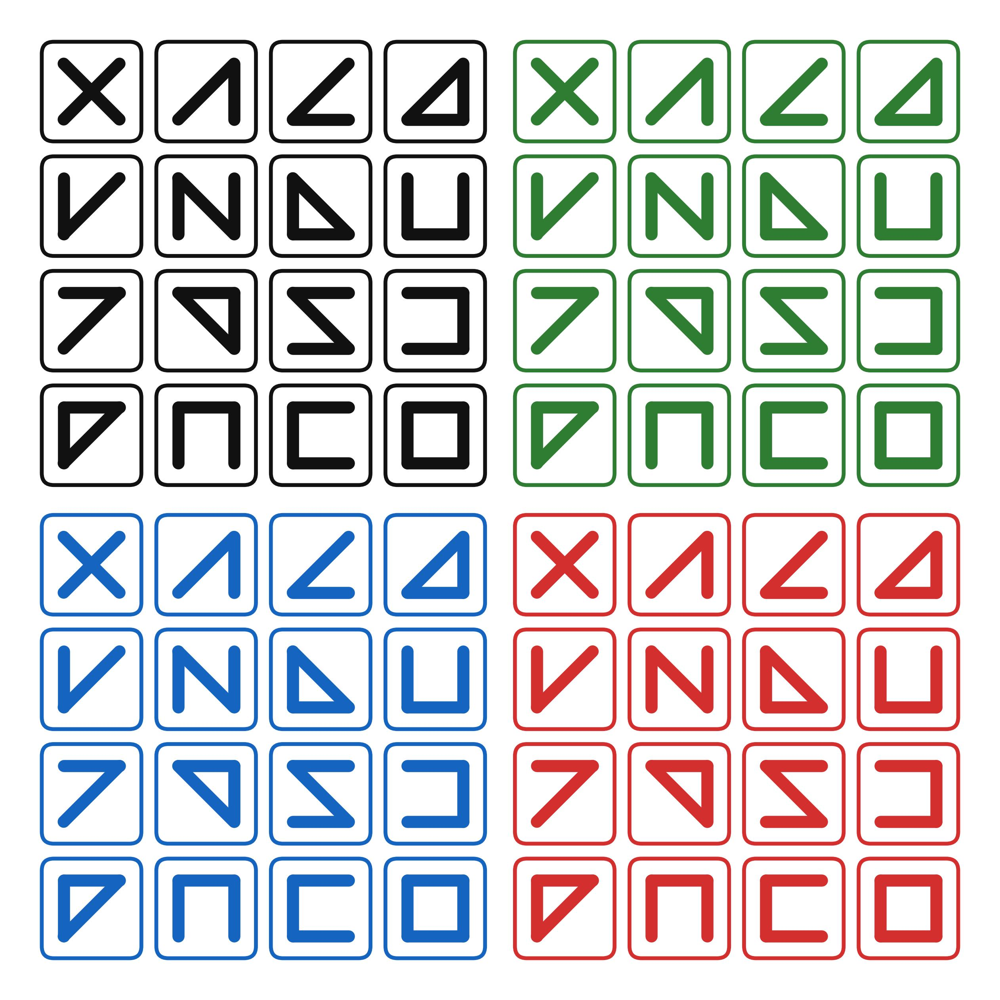
  &nbsp;&nbsp;&nbsp;&nbsp;
  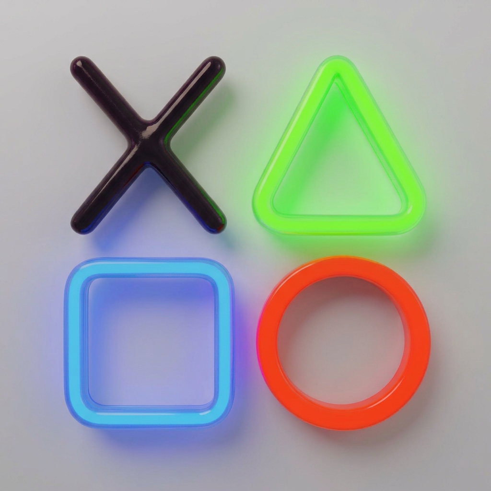
</p>

######  4 Geometric Color Suits

Black Diagonal Crosses,  Green Triangles, Blue Squares, Red Circles 

######  Structure & Ranks
* **16 Sequential Ranks (#0–#15):** Direct 1-to-1 mapping to the 16 core 4-bit YOalphabet glyphs.
* **64 Total Cards:** Complete matrix rendered across all 4 geometric suits.
---

### YOalphabet Machine Encoding

YOalphabet can also be read as a compact visual encoding system
Glyph level: Each YOalphabet glyph corresponds to one 4-bit value ( one glyph represents one nibble )
Byte level: Two glyphs form one byte: first glyph: high nibble; second glyph: low nibble.
Word level: Sixteen glyphs form one 64-bit value: 16 glyphs = 16 nibbles = 8 bytes = 64 bits.
This encoding is optional. YOalphabet is primarily a geometric writing system; binary interpretation is intended for software, identifiers, displays, and machine-readable interfaces.
It does not change the way the script is read, written, or understood as a writing system.


[-Follow%20%40YOalphabet-1DA1F2?style=for-the-badge&logo=x&logoColor=white)](https://x.com/YOalphabet)

### [Try the YOalphabet Converter Online: type or paste text, see the glyphs, and save them as a .jpg. Works offline in any browser.](https://yoalphabet.github.io/YOalphabet/CONVERTER.html)


<p align="center">
  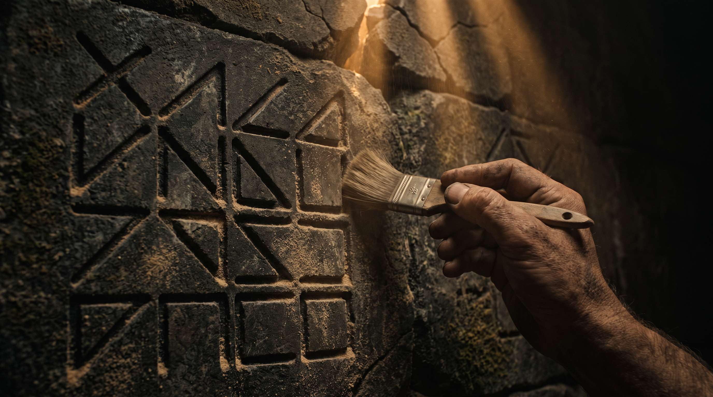
</p>

# PART 2: YOconlang CORE SPECIFICATION

Experimental and unfinished; separate from YOalphabet.
YOconlang uses immutable roots and external grammatical particles. Its vocabulary is organized through a domain–process–target matrix inspired by the MECE principle.

The matrix is intended to make lexical relationships explicit and reduce uncontrolled overlap. Unique coordinates do not, by themselves, guarantee unique interpretations or complete coverage of human experience. Definitions and examples remain necessary.

### Core Architecture and Word Immutability

YOconlang is an a priori engineered language designed for unambiguous, frictionless communication. A foundational axiom of the language is the absolute immutability of roots. There are no inflections, suffixes, declensions, or internal conjugations. Grammatical categories, temporal shifts, and modalities are expressed exclusively via external grammatical particles.
The phonotactics are strictly anchored in the International Phonetic Alphabet (IPA), using 5 core vowels and 11 stable consonants to reduce articulatory difficulty. Stress is fixed invariantly on the first syllable of every separate word.

YOconlang is designed around the MECE principle (Mutually Exclusive, Collectively Exhaustive): every root occupies a unique coordinate in the semantic matrix, and the categories are chosen to minimise overlap and gaps. Coverage and ambiguity are design goals to be tested, not established properties.

**Status and stability.** YOconlang is experimental and pre-1.0. The construction principle is stable: a three-axis matrix (domain – process – target), fixed word templates, immutable uninflected roots, grammatical particles and strict SVO order. The specific categories on each axis, the particle blocks (VV, CV, VC), and individual roots and meanings are a working draft and may change between versions.

The language utilizes strict morphological word templates:

* Verbs, Adjectives, Adverbs: Rigid three-letter roots following the C₁VC₂ structure.
* Nouns: Rigid four-letter roots following the C₁V₁C₂V₂ structure.
* Pronouns and Structural Particles: Two-letter combinations following VC or CV templates.
* System markers: two-vowel forms following the VV pattern.

### Current development status YOconlang
  
| Pattern / Structure Type | Total Possible | Occupied | Free | Comments and Status |
| :--- | :---: | :---: | :---: | :--- |
| **VV** | 25 | 25 | 0 | System markers. |
| **CV** | 55 | 55 | 0 | Relational markers and basic numbers. |
| **VC** | 55 | 55 | 0 | Pronominal quantifiers. |
| **CVC** | 605 | 605 | 0 | Verbs, adverbs, and adjectives. |
| **CVV** | 275 | 0 | 275 | Reserve zone. |
| **CCV** | 605 | 0 | 605 | Reserve zone. |
| **VVC** | 275 | 0 | 275 | Reserve zone. |
| **VCV** | 275 | 0 | 275 | Reserve zone. |
| **VCC** | 605 | 0 | 605 | Reserve zone. |
| **All 4-character combinations** | 65,536 | 3,025 | 62,511 | Only the noun class is occupied. |
| **All 5-character combinations** | 1,048,576 | 0 | 1,048,576 | Reserve zone. |

>  **Implementation Note:** The complete, exhaustive listings and coordinate maps for the **VV** (System Markers), **CV** (Relational Particles), **VC** (Pronominal Quantifiers), and the **Numeric Blocks** have been extracted into standalone, production-ready specification files located directly in the root of this repository for clean modular access.
  
### Strict SVO Word Order and Linear Syntax
The language enforces a rigid, unalterable linear SVO (Subject — Verb — Object) word order. Any form of inversion, omission, or displacement of components is strictly forbidden. 
Since the core roots are completely uninflected, grammatical and syntactic roles are determined solely by their fixed geometric position within the sentence flow.

### Syntax & Phonotactic Compliance Notes:

   1. All word order arrays are strictly restricted to the linear SVO framework.
   2. The rules specify no phonetic reduction or vowel slurring.
   3. Stress assignment is invariantly locked onto the first syllable of every single word unit.

---

## The Semantic Core Matrix (The YOconlang Kernel)

<p align="center">
  
</p>

All lexical meanings and roots are generated systematically through a 3-axis orthogonal matrix based on the Core Kernel.

## Axis 1: C₁ — Domain of Origin (Source Environment)

### 1. Physical World (Objective Reality)
* `l` — Space / Physical Geometry: Coordinates, three-dimensional volume, distance, location.
* `t` — Time / Chronology: Chronological scale, duration of processes, phases, natural cycles.
* `p` — Inanimate Matter: Substances, inorganic materials, artificial objects, tools.
* `b` — Energy and Forces: Physical phenomena, vectors, directional energy fields.

### 2. Organic World & Mind
* `s` — Biosphere and Life: Organic carbon life, flora, fauna, tissues, cells, human physical body.
* `n` — Psyche and Will: Internal mental world, consciousness, emotions, intent, focus of attention.

### 3. Information Environment
* `v` — Primary Perception / Sensory: Raw incoming signals of sense organs before logical analysis.
* `m` — Language and Coding / Semiotics: Interfaces and means of transmitting meaning — signs, tokens, words, syntax.
* `k` — Data and Memory / Statics: Fixed archived information, datasets, blocks of knowledge, files.
* `h` — Thinking and Algorithms / Dynamics: Data processing, logical analysis, computations, runtime code.

### 4. Sociosphere
* `j` — Social sphere: Family, communities, social hierarchies, institutions, economy, network graphs.

## Axis 2: V₁ — Process Vector (Operational Mode)

<p align="center">
  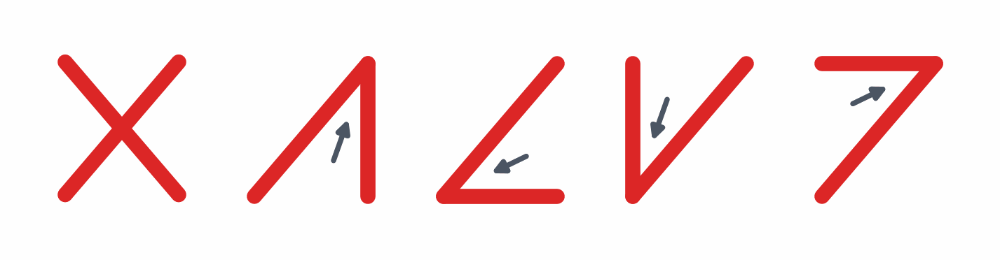
</p>

* `o` — Statics / Being: State of rest, parameter locking, preservation of status quo, immutability.
* `a` — Action / Modification: Active change, generation of a new quality, assembly, creation, work.
* `u` — Counteraction / Destruction: Quality degradation, entropy, structural breakdown, deletion.
* `e` — Import / Perception (Input): Inbound system flow, absorption of external environment, data reading.
* `i` — Export / Expression (Output): Outbound system flow, emission of energy, data writing, transmission.

## Axis 3: C₂ — Target Node of Impact (Objective Destination)
The C₂ consonant maps symmetrically to the exact type of destination entity or environment being impacted by the vector flow:

### 1. Physical World (Objective Reality)
* `l` — Location / Point: Final spatial target, physical landmark, memory coordinate address.
* `t` — Term / Event: Fixed time interval, deadline, timestamp, chronological phase.
* `p` — Object / Instrument: Inanimate material thing, tool, raw physical substance.
* `b` — Element / Directed Force: Directional wave, physical impulse, pressure vector.

### 2. Organic World & Mind
* `s` — Bio-object / Organism: Living individual, biological structure, human body node.
* `n` — Personality / Mental State: Individual consciousness, cognitive target, focus trigger, belief.

### 3. Information Environment
* `v` — Primary Sensation: Raw sensory stimulus, physical receptor excitation.
* `m` — Word / Concept: Explicit linguistic token, entity name, interface identifier, label.
* `k` — Message / Text: Connected block of information, letter, archived dataset, code line.
* `h` — Rule / Algorithm: Explicit code, legal or moral norm, regulation, mathematical calculation.

### 4. Sociosphere
* `j` — Collective / Network Graph: Social group, community, structured network of human or system relations.


[-Follow%20%40YOalphabet-1DA1F2?style=for-the-badge&logo=x&logoColor=white)](https://x.com/YOalphabet)


## Numeral System

<p align="center">
  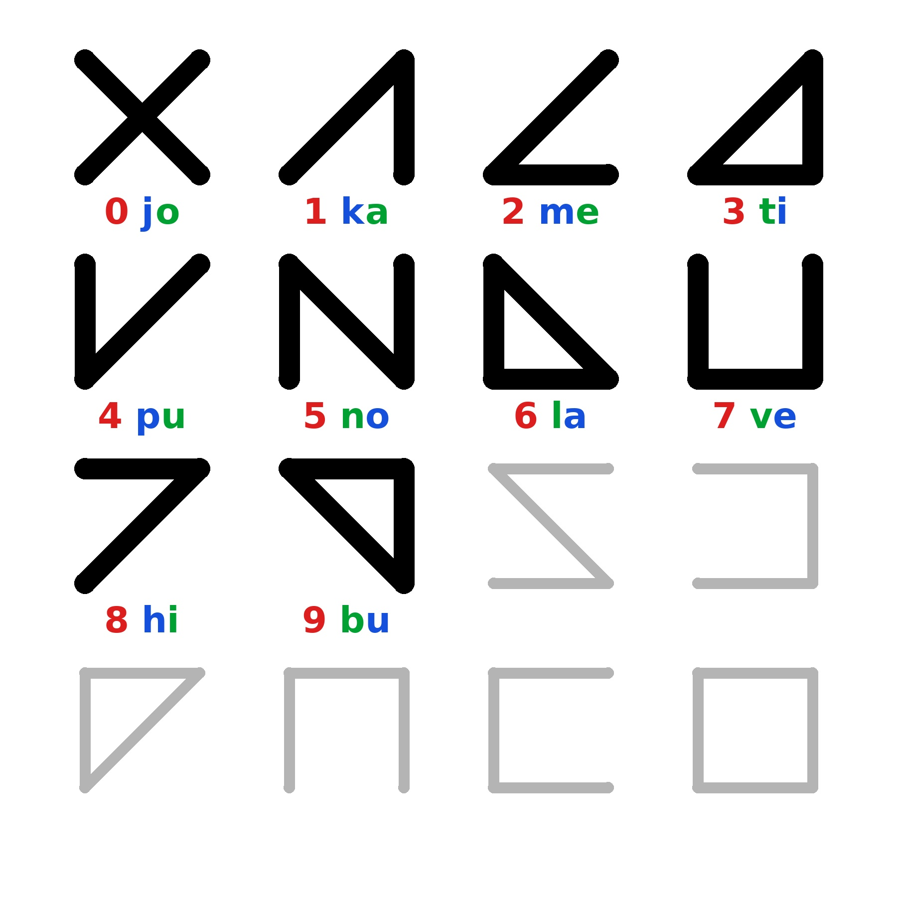
</p>

### Digit Names

The word forms follow a strict `CV` (Consonant-Vowel) pattern:
* Vowels repeat the 5-element cycle `oaeiu` twice across indices 0–9.
* Ten distinct consonants are used, each exactly once.
* In each digit name, one letter—either the consonant or the vowel—corresponds to that digit’s position in the **YOalphabet** sequence, while the second letter completes the `CV` syllable.

| Value | Word Form | YOalphabet IPA |
| :---: | :-------: | :---------: |
| **0** | `jo` | `[o]` |
| **1** | `ka` | `[a]` |
| **2** | `me` | `[e]` |
| **3** | `ti` | `[t]` |
| **4** | `pu` | `[u]` |
| **5** | `no` | `[n]` |
| **6** | `la` | `[l]` |
| **7** | `ve` | `[v]` |
| **8** | `hi` | `[i]` |
| **9** | `bu` | `[b]` |

### Word-Form Notation

The **YOconlang** numeral system supports two distinct notation modes:
* **Word-form notation** ( mode marker **`OO`**)   oo punobujo oo    = 4590  
* **Digit-form notation** (mode marker **`O`**)    o unbo o          = 4590
  
Mode Markers Function: The markers distinguish numeral notation from ordinary lexicon and grammatical text. 

Both modes utilize **positional notation**: a digit’s value is determined strictly by its position in the sequence.

---

<p align="center">
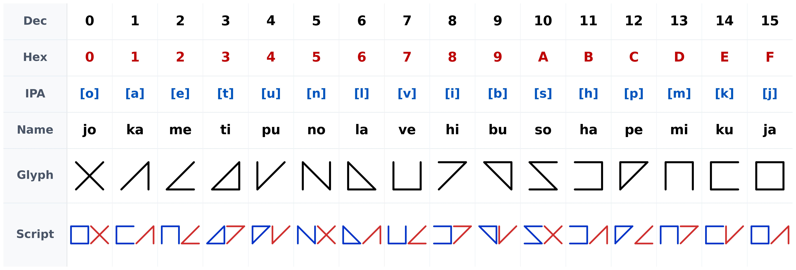
</p>

---
### Hexadecimal Digit Names (10–15)

YOconlang extends this series with direct names for the hexadecimal digits 10–15.  
Each name begins with the consonant sound of the corresponding YOalphabet glyph:

| Value | Word Form | YOalphabet IPA |
| :---: | :-------: | :---------: |
| **10** | so | [s] |
| **11** | ha | [h] |
| **12** | pe | [p] |
| **13** | mi | [m] |
| **14** | ku | [k] |
| **15** | ja | [j] |

The complete hexadecimal digit series is:

```text
jo ka me ti pu no la ve hi bu so ha pe mi ku ja
0  1  2  3  4  5  6  7  8  9  10 11 12 13 14 15
```

For 10–14, the vowel follows the continuing `o–a–e–i–u` cycle.  
For 15, **ja** is used instead of **jo** to avoid duplicating the name of zero.

Some hexadecimal digit names coincide with existing CV forms. Inside the numeral markers `OO … OO` or `O … O`, they are read as digit values, not as grammatical particles.

---

<p align="center">
  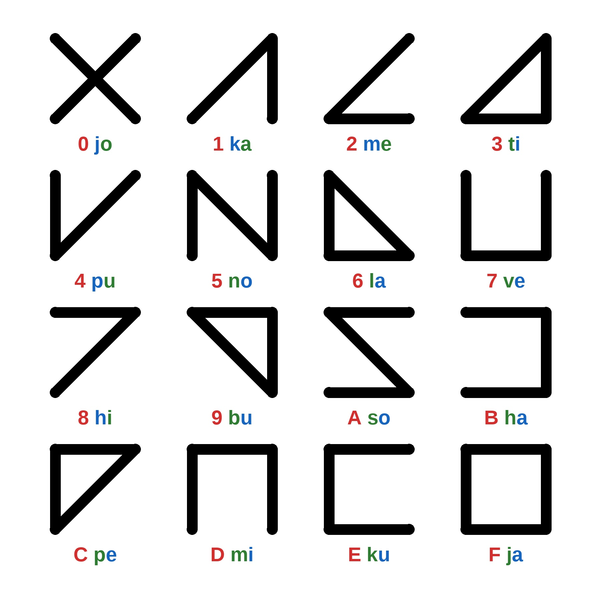
  &nbsp;&nbsp;&nbsp;&nbsp;
  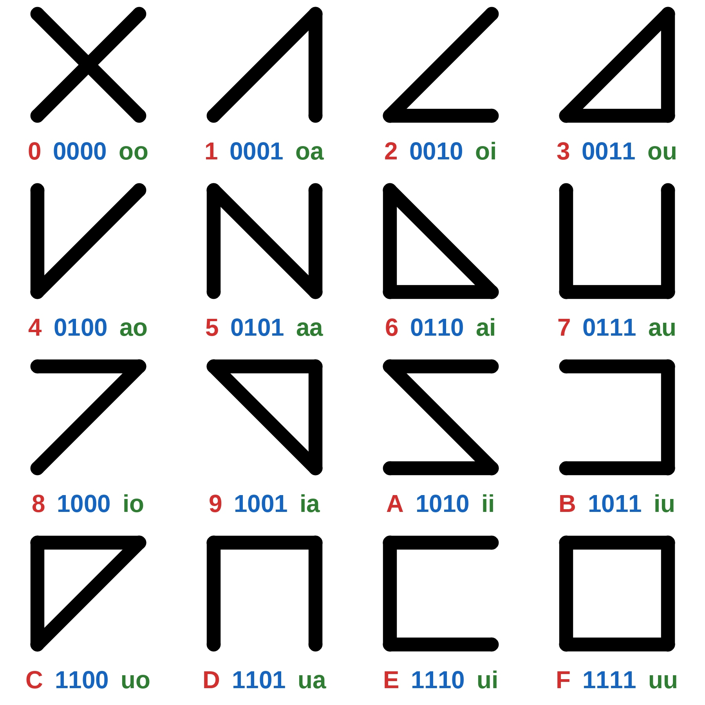
</p>

---

### Scale Markers and Decimal Point

Four more CV forms are reserved as number markers:

| Form | Meaning |
| :---: | :--- |
| `sa` | decimal point (separates the integer and fractional parts) |
| `se` | 10² (hundreds) |
| `su` | 10³ (thousands) |
| `si` | 10⁶ (millions) |

There is no scale marker for 10¹: tens are written positionally (30 = `ti jo`). The form `so` is not a scale marker; it is the hexadecimal digit 10.

Like the digit names, these forms coincide with ordinary CV particles. Inside the numeral markers `OO … OO` or `O … O`, they are read as number markers, not as grammatical particles.

---

**Vowel-pair pronunciation mode:** Each four-bit glyph may be read as two vowels. The upper bit pair selects the first vowel and the lower bit pair selects the second vowel: `00=o`, `01=a`, `10=i`, `11=u`. This produces the sixteen VV names `oo, oa, oi, ou, ao, aa, ai, au, io, ia, ii, iu, uo, ua, ui, uu`.

---

**Letter names:** When YOalphabet glyphs are used as letters, vowel glyphs receive vowel-initial names: `oj` (o), `ak` (a), `em` (e), `up` (u), and `ih` (i). Consonant glyphs retain consonant-initial names: `ti` (t), `no` (n), `la` (l), `ve` (v), `bu` (b), `so` (s), `ha` (h), `pe` (p), `mi` (m), `ku` (k), and `ja` (j). Thus, a letter name always begins with the sound of the letter itself: vowels follow the V+C pattern, while consonants follow the C+V pattern.

The complete letter-name series is:

```text
oj  ak  em  ti  up  no  la  ve  ih  bu  so  ha  pe  mi  ku  ja
o   a   e   t   u   n   l   v   i   b   s   h   p   m   k   j

```

---
[-Follow%20%40YOalphabet-1DA1F2?style=for-the-badge&logo=x&logoColor=white)](https://x.com/YOalphabet)

---

<p align="center">
  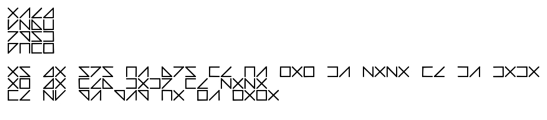
</p>
   YOconlang Translation Specification: Universal Declaration of Human Rights (Article 1) 
    This section provides a complete, granular, word-by-word morphemic breakdown and phonetical transcription 
    of the First Article of the Universal Declaration of Human Rights translated into YOconlang. 
    The translation strictly adheres to the unchangeable root axiom, SVO linear syntax,
    and fixed first-syllable stress phonotactics.


##  Sentence 1: On Birth, Freedom, and Equality of All Human Beings

* Original (American English): "All human beings are born free and equal in dignity and rights."
* YOconlang Orthography: OS TO SIS MA LIS KE MA JOJ HA NONO KE HA HOHO.
* IPA Phonetic Transcription: [ˈos ˈto ˈsis ˈma ˈlis ˈke ˈma ˈjoj ˈha ˈno.no ˈke ˈha ˈho.ho]

##  Word-by-Word Breakdown:

* OS — [os] : Universality pronoun from the approved Block O. Semantics: "All people / All human beings". Functions as the syntactic Subject (S).
* TO — [to] : Grammatical tense particle from Block T. Marks the past perfective tense (Preterite).
* SIS — [sis] : Immutable verbal root from Block 5 (Biosphere & Life). Core semantics: "To release new living organisms outward / To give birth / To reproduce" (Mode I — Outbound/Output Flow).
* MA — [ma] : Functional grammatical marker from Block 8 (Semiotics) that transforms the subsequent root into the Adjective class.
* LIS — [lis] : Immutable three-letter root from Block 1 (Space). Acts as an adjective due to the preceding MA marker. Core semantics: "To release a living organism outside / To liberate the physical body / To grant freedom" (Mode I — Outbound Flow). MA LIS translates directly to "free".
* KE — [ke] : Logical conjunction operator "AND" from Block 9 (Data & Memory).
* MA — [ma] : Repeated functional adjective marker preceding the second quality.
* JOJ — [joj] : Immutable three-letter root from Block 11 (Sociosphere) acting as an adjective. Core semantics: "To preserve an internal network of connections / To be identical to oneself / Equal in status" (Mode O — Statics/Parity). MA JOJ translates directly to "equal".
* HA — [ha] : Procedural operator particle meaning "Regarding / Concerning / In relation to" from Block 10 (Logic). Defines the semantic scope or plane where the qualities manifest.
* NONO — [ˈno.no] : Four-letter Noun structured as C₁V₁C₂V₂. Derived from the mental root NON (self-reflection, tranquility of mind, consciousness) and the final functional vowel O (Substance/Rest). Semantics: "Personal dignity / The inner mental 'Self' of a subject".
* KE — [ke] : Logical conjunction operator "AND".
* HA — [ha] : Repeated procedural operator particle "Regarding / In relation to".
* HOHO — [ˈho.ho] : Four-letter Noun structured as C₁V₁C₂V₂. Derived from the logical root HOH (to execute a pure algorithm) and the final functional vowel O (Substance). Semantics: "Abstract law / Legal right / Unalterable systemic norm".

<p align="center">
  
</p>

##  Design Rationale (Hypotheses to Test)

> This section replaces earlier "advantages" and "applications" lists. Only the first two points are properties of the specification itself; the rest are hypotheses.

* **Deterministic construction (checkable):** a glyph's shape follows from its four edge bits and the diagonal table, and its decimal index is the sum of the active edge weights.
* **Line-density classification (checkable):** in the chosen assignment all five vowels have exactly 2 lines and all eleven consonants have 3 or 4. This is a property of the assignment, not a demonstrated phonetic or perceptual benefit.
* **Simple decoding (hypothesis):** a clean glyph on a known grid could be decoded by sampling four edge positions. Robustness to rotation, blur, perspective and handwriting has not been tested.
* **Regular language structure (hypothesis):** immutable roots, particles and fixed SVO order may be easy for software to parse. Benefits compared with existing languages have not been measured.
* **Not claimed:** compression gains, security or buffer-overflow immunity, energy or hardware savings, replacing token embeddings in language models, or any use in medical, industrial, space or brain-computer-interface settings.

---

## Possible Directions

The following are research directions, not validated deployments:

- Creative writing systems, typography, games, and worldbuilding.
- Educational demonstrations of binary encoding and geometric construction.
- Glyph rendering and constrained visual-recognition experiments.
- Compact symbol encoding for predefined messages and device states.
- Experimental gesture and tactile representations.
- Parsing and generation tools for YOconlang.

Applications in assistive technology, industrial control, or medical communication require additional safety, usability, and reliability evaluation.

---
If you would like to support the project, please contact the author: [X](https://x.com/YOalphabet)

**License:** MIT License. Forks and experiments are welcome.
